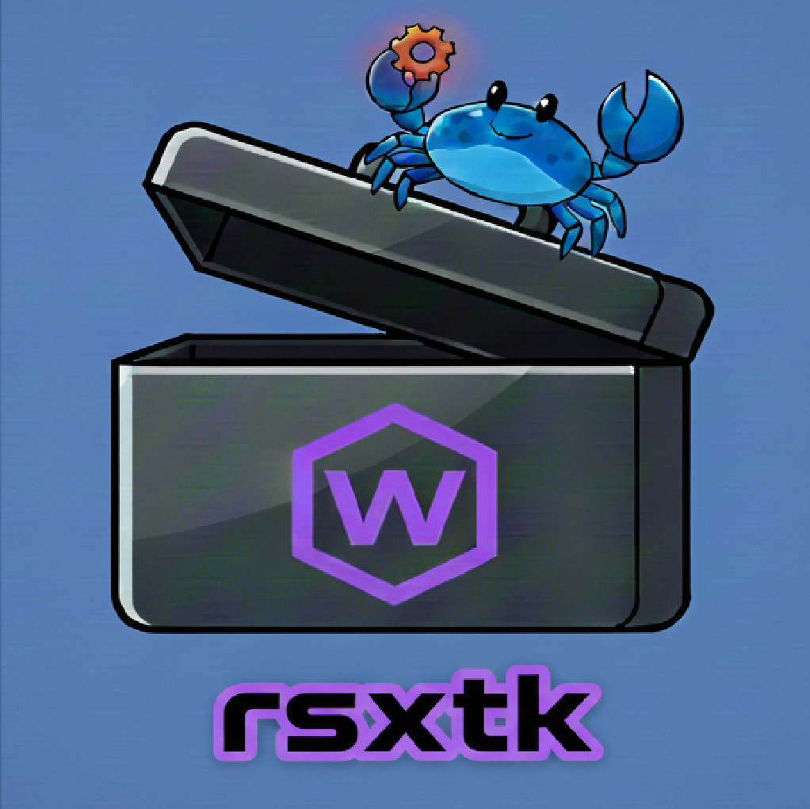

<p align="center">
  
</p>

# rsxtk (Rust Scripting Toolkit) 🦀

`rsxtk` is a high-performance scripting toolkit that allows you to run single Rust files as standalone scripts with automatic dependency management, WASM/WASI compilation, and localized resource support.

This release's test suite was run on:

Tested on: Windows 11 (win-x64)

Tested on: Ubuntu 26.04 LTS under WSL 2 (linux-x64)

Other platforms: not yet tested.

---

## Prerequisites

Before installing `rsxtk`, you must have the Nightly Rust toolchain installed on your system. 
**Get started here: [rust-lang.org/learn/get-started/](https://www.rust-lang.org/learn/get-started/)**

Ensure you have the Nightly Rust toolchain
```bash
rustup install nightly
rustup default nightly
```

and `wasm32-wasip1` target installed:

```bash
rustup target add wasm32-wasip1
```

## Install

```bash
cargo install rsxtk --locked
```

`--locked` builds rsxtk with the exact dependency versions it was tested and released with.

---

## Features

-   **⚡ Script Cache**: A `.rs` script is built once to an optimized `.wasm` and reused until the script changes, so repeated runs skip `cargo`. The cached module is validated on every run. The cache lives in `.tk/` in the current folder; `.tk` may be a link (for example to another drive), but a link inside it is refused, and on Linux and macOS a `.tk` that belongs to another user is refused.
-   **📦 Resource Folder (`rsc/`)**: Keep local assets (HTML, CSV, JSON, etc.) in an `rsc/` folder next to your script. Read them at run time through the sandbox, or embed them at compile time with `include_str!("rsc/…")` / `include_bytes!`. A symlink in `rsc/` is followed when the script is built: the file it points to is copied into the build, so keep only files you trust there.
-   **🔨 build.rs Support**: A `build.rs` next to your script is used as the script's Cargo build script (code generation, `cargo:rustc-env`, and so on).
-   **🔍 Auto-Dependency Versioning**: Adding a dependency without a version fetches the latest release from crates.io. A crate crates.io does not know is an error; if crates.io cannot be reached, `*` is written with a warning so you can pin a version later.
-   **🚀 WASI Preview 1**: Runs on `wasmtime` 50 with `wasmtime-wasi` preview-1, including WASI exit-status handling.
- **Smart Entry**: Attempts to run via `_start` (WASI). If missing, automatically lists callable functions.
- **Library Mode**: Use `mod` to call specific functions with arguments from the CLI.
- **Rich Metadata**: `info` command provides detailed function signatures (params and return types).
- **Format Support**: Direct support for `.rs`, `.wasm` and `.wat`. Precompiled `.cwasm` files are refused: they are native code that cannot be validated, so they would run outside the sandbox.
- **WAT ⇄ WASM**: `convert` translates between text and binary; `optimize` rewrites a module through Walrus.
- **Benchmarking**: `bench` runs a module or script N times and reports the average.
- **Zero-Config WASI**: Scripts are automatically sandboxed to their own parent directory, read-only unless you pass `--allow-write`.

---

## Quick Start

### 1. Initialize a Script
```bash
rsxtk init my_script.rs
```

### 2. Add Dependencies
Add a crate (it will automatically find the latest version for you):
```bash
rsxtk add my_script.rs reqwest
```

### 3. Remove Dependencies
Remove a crate from the script's manifest:
```bash
rsxtk remove my_script.rs reqwest
```

### 4. Manage Resources
Create an `rsc/` folder in the current directory (or pass a directory: `rsxtk resource <dir>`):
```bash
rsxtk resource
```
Place your local files in the new `rsc/` folder, next to your script. The script's folder is the sandbox root, so read them at run time with a relative path:
```rust
let text = std::fs::read_to_string("rsc/greeting.txt").expect("read rsc/greeting.txt");
```
Or embed a file into the module at compile time (rebuilt when the file changes):
```rust
const TEXT: &str = include_str!("rsc/greeting.txt");
```

### 5. Run (WASM Sandbox)
Compiles to WASM and runs in a secure, sandboxed environment.
```bash
rsxtk run my_script.rs
```

### 6. Csrun (Native)
Runs natively on the host using the Cargo script interface.
```bash
rsxtk csrun my_script.rs
```

---

## CLI Command Reference

| Command | Usage | Description |
| :--- | :--- | :--- |
| `run` | `rsxtk run <file>` | Runs a `.rs`, `.wasm` or `.wat` file in the WASI sandbox; without `_start`, lists callable functions. A `.cwasm` is refused. |
| `mod` | `rsxtk mod <file> [function] [args]...` | Calls an exported function with CLI arguments (`i32`/`i64`/`f32`/`f64`); with no function, shows the module info. |
| `csrun` | `rsxtk csrun <file>` | Runs file natively via `cargo -Z script`. |
| `build` | `rsxtk build <file> <target>` | Builds a script to `wasi` or `wasm` (writes `<file>.wasm`), or `wat` (also writes `<file>.wat`). |
| `convert` | `rsxtk convert <input> [-o <output>]` | Converts `.wasm` ⇄ `.wat` (an output naming the input is refused). |
| `init` | `rsxtk init <name>` | Creates a new script with a manifest header (never overwrites an existing file). The name becomes the script's Cargo package name, so it starts with a letter or `_` and holds only letters, digits, `-` and `_` (not `build`, `deps`, `examples`, `incremental`); `run` refuses other names with the same message. |
| `initmod` | `rsxtk initmod <name>` | Creates a new library-module template (exports `add`); call it with `rsxtk mod <name>.rs add 2 3`. A script without `fn main` is built as a library. |
| `resource` | `rsxtk resource [dir]` | Creates an `rsc/` folder for local assets (default: current directory). |
| `bench` | `rsxtk bench <file> [-i <n>]` | Runs the file `n` times (default 5) and prints the average time. |
| `add` | `rsxtk add <file> <crate> [version]` | Adds a dependency to the script manifest (latest version if omitted). The version is a Cargo version requirement such as `1`, `1.2`, `^1.2.3`, `~0.4`, `>=1, <2` or `*`. |
| `remove` | `rsxtk remove <file> <crate>` | Removes a dependency from the script manifest. |
| `list` | `rsxtk list <file>` | Lists current dependencies in the script. |
| `fmt` | `rsxtk fmt <file>` | Formats the Rust code inside the script with `rustfmt` (edition 2021), preserving the manifest; if rustfmt fails or runs longer than 2 minutes, the file is left unchanged. |
| `optimize` | `rsxtk optimize -i <input> [-o <output>]` | Rewrites a `.wasm` through Walrus (overwrites the input if `-o` is omitted). |
| `clean` | `rsxtk clean` | Wipes the `.tk` build cache. |
| `info` | `rsxtk info <file>` | Shows exported functions with their signatures, and whether the module uses WASI. |

**The sandbox** (`run`, `mod`, `bench`): a guest sees its own folder as `.`, **read-only**, plus its arguments and stdio — never your environment variables. Pass `--allow-write` to let it create, change and delete files in that folder (for example `rsxtk run --allow-write report.rs`); keep modules from elsewhere in a folder of their own before you do. All of a guest's memories and tables together may use at most 4096 MiB; `--max-memory <MiB>` changes that budget (a `memory.grow` or `table.grow` past it returns -1). There is no time limit: a guest that loops forever runs until you stop it with Ctrl-C.

---

## Breaking Changes

What changed in a way that can break a script or a command line you already use, and what to do. From 1.0.0 on, a change like these comes only with a new major version.

### 1.0.0 (from 0.5.x)

| What changed | Before (0.5.x) | Now (1.0.0) | What to do |
| :--- | :--- | :--- | :--- |
| Writing files from a guest | A guest could create, change and delete any file in its folder | Its folder is **read-only** | Add `--allow-write` when the module or script must write: `rsxtk run --allow-write app.wasm` |
| Guest memory | No limit | All of a guest's memories and tables together: at most 4096 MiB (`memory.grow` / `table.grow` past it return -1) | Raise it if needed: `rsxtk --max-memory 8192 run app.wasm` |
| `.cwasm` files | `run`, `mod`, `bench` and `info` loaded them | Refused: precompiled native code cannot be checked | Run the `.wasm`, `.wat` or `.rs` it was built from |
| `add` without a version, for a crate crates.io does not have | Wrote `name = "*"` and reported success | An error; nothing is written | Check the crate's name |
| `add` / `remove` with an unusual manifest | Could duplicate a dependency, put it in the wrong table, or drop lines — and report success | Refused with a message, the file unchanged, when there is text before the `---` block or a multi-line string (`"""`, `'''`), and when `remove` targets an entry whose `{` or `[` never closes | Move the manifest to the top of the file, close the entry, or edit those lines by hand |
| `mod <file> <fn> <args>…` with too many arguments | Extra arguments were ignored | An error naming how many the function takes | Pass exactly the function's arguments |
| `init` / `initmod` on an existing file | The file was replaced by the template | Refused; the file is unchanged | Remove or rename the file first |
| `fmt` | Formatted as Rust 2015 and reported success even when rustfmt failed | Formats as Rust 2021; a rustfmt failure is an error and the file is unchanged | Fix the code rustfmt points to |
| `convert x.wasm -o x.wasm` | Replaced the input with the other format | Refused | Give a different output name |

Build caches made by 0.5.x (`.tk/`) are rebuilt automatically; no action is needed.

---

## Technical Details

### The Build Pipeline
When you run a script, `rsxtk` performs the following steps:
1.  **Parsing**: Separates the TOML manifest from the Rust source code using triple-dash boundaries.
2.  **Mirroring**: Writes the manifest and the code into a hidden `Cargo` project at `.tk/<script>/` in the current directory — as a binary when the script has `fn main`, otherwise as a library (`cdylib`).
    -   Copies `build.rs` (if present next to the script) into the project root.
    -   Copies the `rsc/` folder (if present) into the project's `src/`, so `include_str!("rsc/…")` resolves as it does next to the script.
    -   A change to the script, `build.rs` or anything in `rsc/` triggers a rebuild.
3.  **'run' option**
    - **Compilation**: Invokes `cargo` to target `wasm32-wasip1` (release).
    - **Optimization**: Passes the result through Walrus, validates it, and caches it as `.tk/<script>/<script>.wasm`. Later runs reuse it until the script changes, skipping `cargo`; the module is validated and compiled by Cranelift on each run.
    - **Sandboxing**: Runs the artifact in a WASI sandbox with the script's own folder pre-opened as `.` for file access.
4.  **'csrun' option**: runs the cargo -Z script from the nightly version of rust

---

## 🌟 Code Examples

### 1. Fibonacci (Rust Script)
Create `fib.rs`:
```rust
---
[dependencies]
---
fn main() {
    let mut a = 0;
    let mut b = 1;
    println!("Fibonacci sequence:");
    for _ in 0..10 {
        println!("{}", a);
        let temp = a;
        a = b;
        b = temp + b;
    }
}
```
**Run:** `rsxtk run fib.rs`

### 2. Hello World (WAT)
Create `hello.wat`:
```wat
(module
  (import "wasi_snapshot_preview1" "fd_write" (func $fd_write (param i32 i32 i32 i32) (result i32)))
  (memory 1)
  (export "memory" (memory 0))
  (data (i32.const 8) "Hello, Rosetta Code!\n")
  (func $main (export "_start")
    (i32.store (i32.const 0) (i32.const 8))
    (i32.store (i32.const 4) (i32.const 21))
    (call $fd_write (i32.const 1) (i32.const 0) (i32.const 1) (i32.const 24))
    drop
  )
)
```
**Run:** `rsxtk run hello.wat`

---

## ⚙️ How it Works
When you run a `.rs` file, `rsxtk` creates a hidden virtual Cargo project in the `.tk/` directory. It manages dependencies, compiles the script to `wasm32-wasip1`, optimizes the result and caches it as a plain `.wasm`, which is validated and compiled each time it runs.

---

## 🔒 Privacy

`rsxtk` collects nothing and sends no telemetry. Its one network request of its own is `rsxtk add <file> <crate>` without a version, which asks crates.io for that crate's latest version (sending the crate name and the User-Agent `rsxtk/<version> (+https://github.com/synapticforge1/rsxtk)`). Building a script runs `cargo`, which downloads the script's dependencies from crates.io as usual. Build output stays on your machine, in `.tk/` in the current folder; `rsxtk clean` removes it. `add`, `remove` and `fmt` take a lock per script — an empty file named by a hash of the script's path — so two runs on one script never lose each other's edits; a run that finds the script locked says so and gives up after 60 seconds. The lock files are kept, one per script you have edited, in a folder only you can use: `rsxtk-locks` in your temp folder on Windows and macOS, `~/.cache/rsxtk/locks` (or `$XDG_CACHE_HOME/rsxtk/locks`) on Linux. Delete that folder whenever no rsxtk run is active; `rsxtk clean` does not touch it.

---

## 🛠 Troubleshooting (Windows & Environment)

### 1. "Access is Denied" or "Path Not Found" (UNC Paths)
On Windows, if your project is deep within a folder structure, you may encounter errors related to UNC paths (paths starting with `\\?\`).
* **Solution**: Move the project closer to the root of your drive (e.g., `C:\src\`).
* **Alternative**: Enable **Long Paths** in Windows via PowerShell (Admin):
  `New-ItemProperty -Path "HKLM:\System\CurrentControlSet\Control\FileSystem" -Name "LongPathsEnabled" -Value 1 -PropertyType DWORD -Force`

### 2. build.rs Runs Outside the Sandbox
A `build.rs` is a normal program that Cargo compiles and runs on your machine during the build, like any Cargo build script — only the finished script runs in the WASI sandbox. Every script in the same folder shares that folder's `build.rs` and `rsc/`; keep scripts that need different ones in different folders.

### 3. Cargo Build Failures
* Ensure the WASM target is installed: `rustup target add wasm32-wasip1`.
* **Clean Cache**: If builds become corrupted, run `rsxtk clean`.

### 4. Wasmtime Execution Errors
* **"magic header not detected"**: the file is not a WebAssembly binary — for example WAT text saved with a `.wasm` name. Give a text module the `.wat` extension, or convert it with `rsxtk convert <file>.wat`.
* **".cwasm … does not run it"**: rsxtk no longer runs precompiled `.cwasm` files (they skip validation). Run the `.wasm`, `.wat` or `.rs` they were made from. A `.tk/` cache from an older rsxtk is rebuilt automatically.

### 5. Wasmtime Version Compatibility

`rsxtk` uses **wasmtime 50.x** with its default features turned off. That keeps C libraries such as `aws-lc-sys` (which needs **NASM** and **cmake**) out of the build: installing rsxtk needs only a Rust toolchain, which compiles wasmtime's two small C helper files itself.
