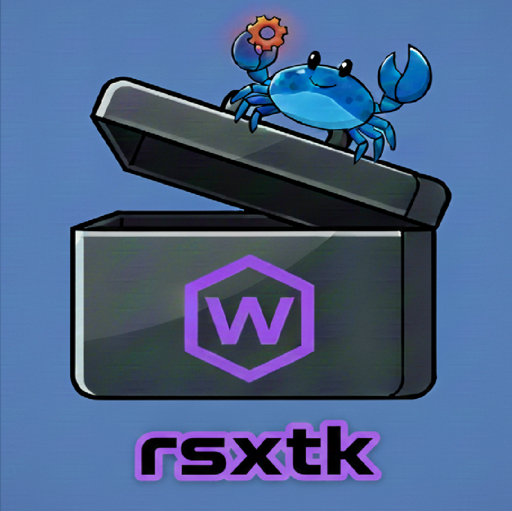

<p align="center">
  
</p>

# rsxtk (Rust Scripting Toolkit) 🦀

`rsxtk` is a high-performance scripting toolkit that allows you to run single Rust files as standalone scripts with automatic dependency management, WASM/WASI compilation, and localized resource support.


---

## Prerequisites

Before installing `rsxtk`, you must have the Nightly Rust toolchain installed on your system. 
**Get started here: [rust-lang.org/learn/get-started/](https://www.rust-lang.org/learn/get-started/)**

Ensure you have the Nightly Rust toolchain
```bash
rustup install nightly
rustup default nightly
```

and `wasm32-wasip1` target installed:

```bash
rustup target add wasm32-wasip1
```

---

## Features

-   **⚡ Compiled-Script Cache**: A `.rs` script is compiled once to a native `.cwasm` artifact for your CPU and reused until the script changes, so repeated runs skip both `cargo` and Cranelift.
-   **📦 Resource Folder (`rsc/`)**: Keep local assets (HTML, CSV, JSON, etc.) in an `rsc/` folder next to your script. Read them at run time through the sandbox, or embed them at compile time with `include_str!("rsc/…")` / `include_bytes!`.
-   **🔨 build.rs Support**: A `build.rs` next to your script is used as the script's Cargo build script (code generation, `cargo:rustc-env`, and so on).
-   **🔍 Auto-Dependency Versioning**: Adding a dependency without a version fetches the latest release from crates.io (falls back to `*` if crates.io cannot be reached).
-   **🚀 WASI Preview 1**: Runs on `wasmtime` 40 with `wasmtime-wasi` preview-1, including WASI exit-status handling.
- **Smart Entry**: Attempts to run via `_start` (WASI). If missing, automatically lists callable functions.
- **Library Mode**: Use `mod` to call specific functions with arguments from the CLI.
- **Rich Metadata**: `info` command provides detailed function signatures (params and return types).
- **Format Support**: Direct support for `.rs`, `.wasm`, `.wat`, and `.cwasm`.
- **WAT ⇄ WASM**: `convert` translates between text and binary; `optimize` rewrites a module through Walrus.
- **Benchmarking**: `bench` runs a module or script N times and reports the average.
- **Zero-Config WASI**: Scripts are automatically sandboxed to their own parent directory.

---

## Quick Start

### 1. Initialize a Script
```bash
rsxtk init my_script.rs
```

### 2. Add Dependencies
Add a crate (it will automatically find the latest version for you):
```bash
rsxtk add my_script.rs reqwest
```

### 3. Remove Dependencies
Remove a crate from the script's manifest:
```bash
rsxtk remove my_script.rs reqwest
```

### 4. Manage Resources
Create an `rsc/` folder in the current directory (or pass a directory: `rsxtk resource <dir>`):
```bash
rsxtk resource
```
Place your local files in the new `rsc/` folder, next to your script. The script's folder is the sandbox root, so read them at run time with a relative path:
```rust
let text = std::fs::read_to_string("rsc/greeting.txt").expect("read rsc/greeting.txt");
```
Or embed a file into the module at compile time (rebuilt when the file changes):
```rust
const TEXT: &str = include_str!("rsc/greeting.txt");
```

### 5. Run (WASM Sandbox)
Compiles to WASM and runs in a secure, sandboxed environment.
```bash
rsxtk run my_script.rs
```

### 6. Csrun (Native)
Runs natively on the host using the Cargo script interface.
```bash
rsxtk csrun my_script.rs
```

---

## CLI Command Reference

| Command | Usage | Description |
| :--- | :--- | :--- |
| `run` | `rsxtk run <file>` | Runs a `.rs`, `.wasm`, `.wat` or `.cwasm` file in the WASI sandbox; without `_start`, lists callable functions. |
| `mod` | `rsxtk mod <file> [function] [args]...` | Calls an exported function with CLI arguments (`i32`/`i64`/`f32`/`f64`); with no function, shows the module info. |
| `csrun` | `rsxtk csrun <file>` | Runs file natively via `cargo -Z script`. |
| `build` | `rsxtk build <file> <target>` | Builds a script to `wasi` or `wasm` (writes `<file>.wasm`), or `wat` (also writes `<file>.wat`). |
| `convert` | `rsxtk convert <input> [-o <output>]` | Converts `.wasm` ⇄ `.wat`. |
| `init` | `rsxtk init <name>` | Creates a new script with a manifest header. |
| `initmod` | `rsxtk initmod <name>` | Creates a new library-module template (exports `add`); call it with `rsxtk mod <name>.rs add 2 3`. A script without `fn main` is built as a library. |
| `resource` | `rsxtk resource [dir]` | Creates an `rsc/` folder for local assets (default: current directory). |
| `bench` | `rsxtk bench <file> [-i <n>]` | Runs the file `n` times (default 5) and prints the average time. |
| `add` | `rsxtk add <file> <crate> [version]` | Adds a dependency to the script manifest (latest version if omitted). |
| `remove` | `rsxtk remove <file> <crate>` | Removes a dependency from the script manifest. |
| `list` | `rsxtk list <file>` | Lists current dependencies in the script. |
| `fmt` | `rsxtk fmt <file>` | Formats the Rust code inside the script (preserving manifest). |
| `optimize` | `rsxtk optimize -i <input> [-o <output>]` | Rewrites a `.wasm` through Walrus (overwrites the input if `-o` is omitted). |
| `clean` | `rsxtk clean` | Wipes the `.tk` build cache. |
| `info` | `rsxtk info <file>` | Shows exported functions with their signatures, and whether the module uses WASI. |

---

## Technical Details

### The Build Pipeline
When you run a script, `rsxtk` performs the following steps:
1.  **Parsing**: Separates the TOML manifest from the Rust source code using triple-dash boundaries.
2.  **Mirroring**: Writes the manifest and the code into a hidden `Cargo` project at `.tk/<script>/` in the current directory — as a binary when the script has `fn main`, otherwise as a library (`cdylib`).
    -   Copies `build.rs` (if present next to the script) into the project root.
    -   Copies the `rsc/` folder (if present) into the project's `src/`, so `include_str!("rsc/…")` resolves as it does next to the script.
    -   A change to the script, `build.rs` or anything in `rsc/` triggers a rebuild.
3.  **'run' option**
    - **Compilation**: Invokes `cargo` to target `wasm32-wasip1` (release).
    - **Optimization**: Passes the result through Walrus, pre-compiles it into a `.cwasm` artifact for your CPU, and caches it. Later runs reuse the `.cwasm` until the script changes or the machine changes, skipping `cargo` and Cranelift entirely.
    - **Sandboxing**: Runs the artifact in a WASI sandbox with the script's own folder pre-opened as `.` for file access.
4.  **'csrun' option**: runs the cargo -Z script from the nightly version of rust

---

## 🌟 Code Examples

### 1. Fibonacci (Rust Script)
Create `fib.rs`:
```rust
---
[dependencies]
---
fn main() {
    let mut a = 0;
    let mut b = 1;
    println!("Fibonacci sequence:");
    for _ in 0..10 {
        println!("{}", a);
        let temp = a;
        a = b;
        b = temp + b;
    }
}
```
**Run:** `rsxtk run fib.rs`

### 2. Hello World (WAT)
Create `hello.wat`:
```wat
(module
  (import "wasi_snapshot_preview1" "fd_write" (func $fd_write (param i32 i32 i32 i32) (result i32)))
  (memory 1)
  (export "memory" (memory 0))
  (data (i32.const 8) "Hello, Rosetta Code!\n")
  (func $main (export "_start")
    (i32.store (i32.const 0) (i32.const 8))
    (i32.store (i32.const 4) (i32.const 21))
    (call $fd_write (i32.const 1) (i32.const 0) (i32.const 1) (i32.const 24))
    drop
  )
)
```
**Run:** `rsxtk run hello.wat`

---

## ⚙️ How it Works
When you run a `.rs` file, `rsxtk` creates a hidden virtual Cargo project in the `.tk/` directory. It manages dependencies, compiles the script to `wasm32-wasip1`, and then pre-compiles that WASM into a native `.cwasm` file for your specific CPU architecture. 

---

## 🛠 Troubleshooting (Windows & Environment)

### 1. "Access is Denied" or "Path Not Found" (UNC Paths)
On Windows, if your project is deep within a folder structure, you may encounter errors related to UNC paths (paths starting with `\\?\`).
* **Solution**: Move the project closer to the root of your drive (e.g., `G:\rsxtk_projects\`).
* **Alternative**: Enable **Long Paths** in Windows via PowerShell (Admin):
  `New-ItemProperty -Path "HKLM:\System\CurrentControlSet\Control\FileSystem" -Name "LongPathsEnabled" -Value 1 -PropertyType DWORD -Force`

### 2. build.rs Runs Outside the Sandbox
A `build.rs` is a normal program that Cargo compiles and runs on your machine during the build, like any Cargo build script — only the finished script runs in the WASI sandbox. Every script in the same folder shares that folder's `build.rs` and `rsc/`; keep scripts that need different ones in different folders.

### 3. Cargo Build Failures
* Ensure the WASM target is installed: `rustup target add wasm32-wasip1`.
* **Clean Cache**: If builds become corrupted, run `rsxtk clean`.

### 4. Wasmtime Execution Errors
* **Unsupported ELF Header**: Occurs if a `.wat` file wasn't converted or a `.cwasm` is incompatible. Run `rsxtk clean` and try again.

### 5. Wasmtime Version Compatibility

`rsxtk` is pinned to **wasmtime 40.x**. Versions 42.x and later reintroduce `aws-lc-sys` into the dependency chain, which requires **NASM** and **cmake** to build. On Windows environments without those tools the build will fail with `Missing dependency: cmake`. Do not upgrade wasmtime until NASM and cmake are available, or until an alternative pure-Rust crypto path is available in that version.
